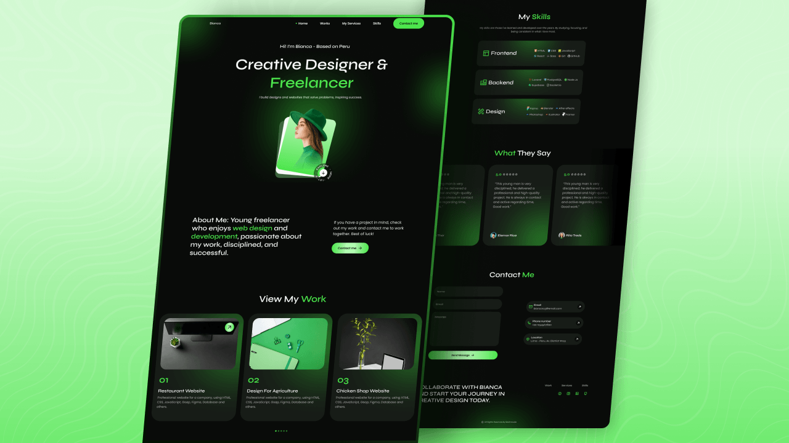

# Responsive Portfolio Website Ali Hossen

This project is part of a step-by-step YouTube tutorial in which we build a responsive portfolio website Bianca from scratch using HTML, CSS and JavaScript.

 

 

## 📌 Project Features
- Fully responsive portfolio website Bianca (Mobile First Methodology).
- Clear and semantic HTML structure.
- Use of CSS variables and modern JavaScript functions.
- Smooth scrolling between sections.
- Scroll animations.
- Compatible with all modern browsers and devices.
